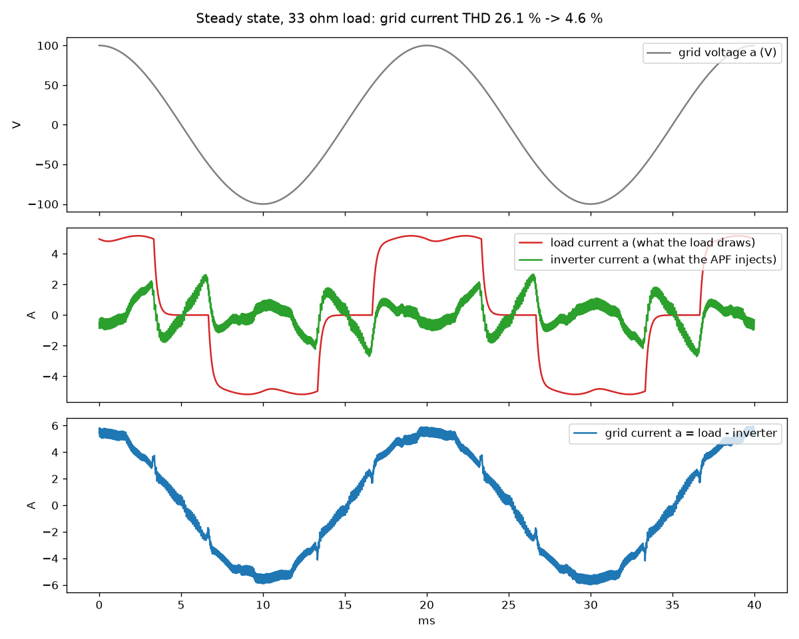
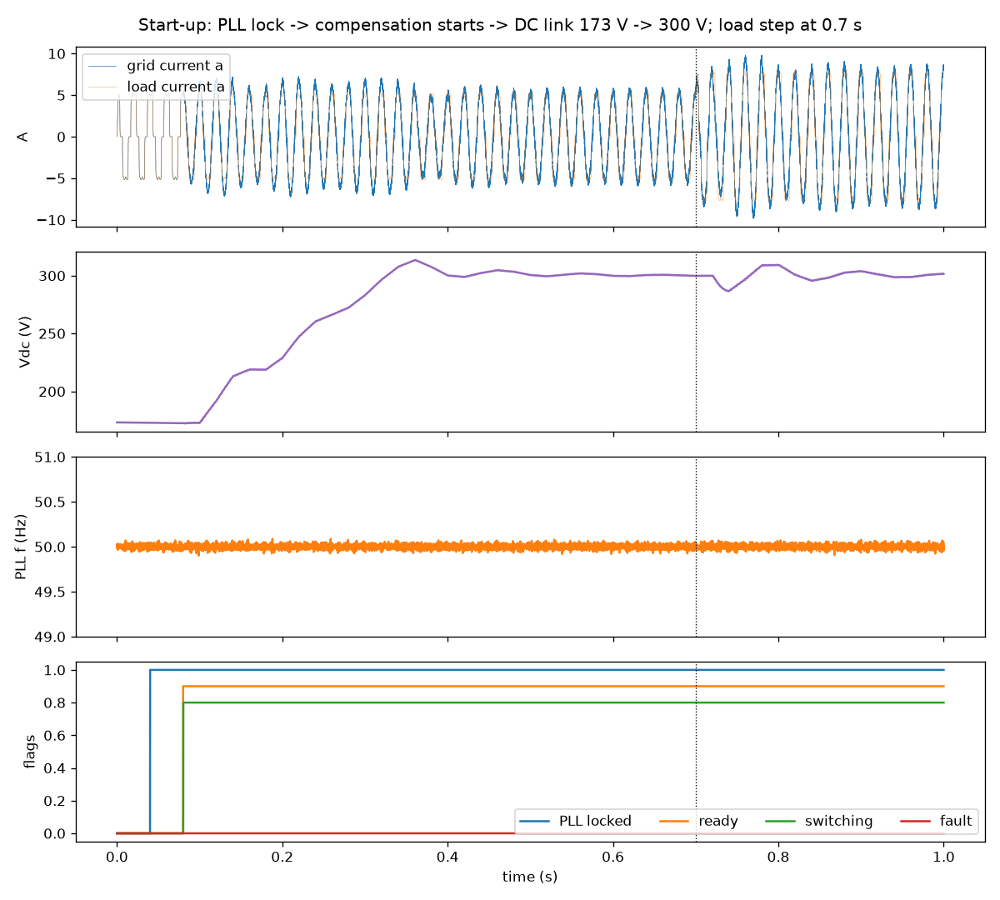
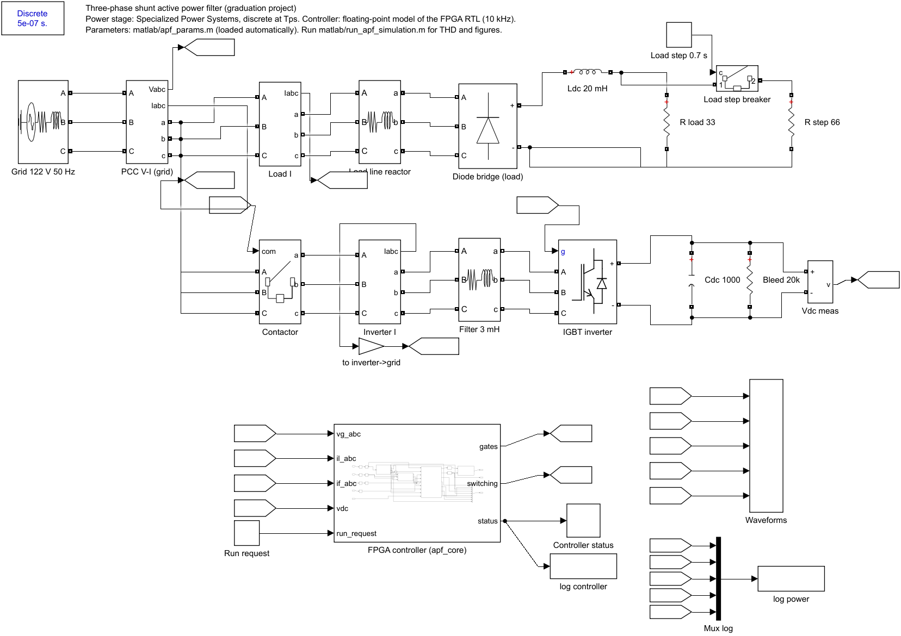

# APF FPGA: three-phase VSI shunt active power filter (DE1-SoC)

Working project for the FPGA part of the graduation project. Target chip:
Cyclone V SoC **5CSEMA5F31C6** (Terasic DE1-SoC), 50 MHz clock.
The original ChatGPT-era packages are kept unchanged as a backup in `Desktop\H1`.

## Using this project on any PC

Nothing in the source depends on a user name or folder. Copy the APF_FPGA folder
anywhere and always run commands from inside it.

Each person needs:
- **Quartus Prime Lite** with Cyclone V support. Its installer sets QUARTUS_ROOTDIR, which the scripts use.
- **Questa - Altera FPGA Starter Edition** with **their own free license**.
  The license is locked to one PC's network card, so a license file can't be shared.
- **Python 3** with 
umpy and matplotlib. This is only for the models and the plots.

First time on a new PC:
1. Open Questa from the Start menu.
2. Go to **File > Change Directory** and pick the APF_FPGA folder.
3. In the Transcript, type do sim/make_project.do.
   This creates APF_FPGA.mpf with that PC's paths and compiles everything.
4. Later, use **File > Open > Project > APF_FPGA.mpf**.

**Share:** 
tl/, sim/*.sv, sim/*.do, sim/*.txt, model/*.py,
quartus/check_timing.ps1, quartus/apf_reference_check.qpf/.qsf/.sdc and this README.

**Don't share** (generated on each PC; listed in .gitignore): work/, *.mpf,
modelsim.ini, 	ranscript, *.wlf, sim/out/, quartus/check_*/, and the Quartus db/ and report files.

## Folders

| Folder | Contents |
|---|---|
| `rtl/` | Hardware code that goes on the FPGA |
| `sim/` | Questa testbenches and the 3,582 independent test vectors (simulation only) |
| `quartus/` | Quartus project used to prove the design fits and meets timing on 5CSEMA5F31C6 |

## apf_reference revision 2 (22 Oct 2026)

Revision 1 was functionally correct but failed timing on the DE1-SoC chip.
Revision 2 keeps the same ports, the same 7-clock latency and **bit-identical results**.

| Change | Why |
|---|---|
| Divide by 196608 replaced by `sign * ((|S| >> 15) * 349526) >> 20` | Exact for every reachable input (checked exhaustively); removes a 37-bit hardware divider |
| Divide by WINDOW replaced by multiply with `ceil(2^K / WINDOW)`, `K = 2*clog2(WINDOW)+17` | Exact for all reachable sums (checked exhaustively for WINDOW = 1, 2, 3, 200); removes a 26-bit divider |
| Averaging history moved to a synchronous-read RAM | Maps to one block RAM instead of ~3,600 flip-flops |

### Results on 5CSEMA5F31C6, Quartus Prime Lite 25.1, 50 MHz constraint

| | Revision 1 | Revision 2 |
|---|---:|---:|
| Worst setup slack (slow 85 C) | -29.2 ns (fails) | **+9.7 ns (passes, about 97 MHz)** |
| Logic (ALMs) | 2,618 | 241 |
| Registers | 3,915 | 307 |
| Block RAM | 0 | 1 |
| DSP blocks | 6 | 8 |

All original testbenches pass unchanged: `tb_apf_reference` (3,582 vectors),
`tb_reference_parameters`, `tb_reference_guard` (8 groups), `tb_reference_demo`.

## PWM and measurement blocks (22 Oct 2026)

Copied unchanged from the backup. All their tests still pass (PWM: 9 groups;
measurement: 13 groups plus the parameter corner cases).

| Block | ALMs | Registers | Worst setup slack at 50 MHz |
|---|---:|---:|---:|
| `three_phase_pwm` | 205 | 166 | +10.65 ns |
| `measurement_frontend` | 32 | 56 | +16.93 ns |

The 3 synthesis warnings in `three_phase_pwm.sv` (lines 135/139/143) come from
`DEAD_CYCLES` (a 32-bit constant) being written into the 7-bit dead-time
timer. The value (100) fits, so they are harmless.

## srf_pll: grid angle estimator (22 Oct 2026)

`rtl/srf_pll.sv` is a three-phase synchronous-reference-frame PLL. It supplies
`cos_a/b/c` and `angle_valid` to `apf_reference`, plus `sin_a/b/c`, frequency,
amplitude and phase error.

How it works, once per 10 kHz frame (about 85 clocks of the 5,000 available):

1. Rotate the three voltages into d/q using the angle predicted for this sample.
2. Divide q by the voltage magnitude (`sqrt(d^2+q^2)`, computed bit by bit).
   This makes the loop gain independent of grid voltage and sensor scaling.
3. Run a PI loop designed for 20 Hz bandwidth with damping 0.707 (KP = 185, KI = 422/256).
   Frequency is limited to 45-55 Hz, with anti-windup.
4. Advance a 32-bit phase accumulator. Then read cos/sin for the *next* sample
   from a 4,096-entry table in block RAM, so they are ready before that sample arrives.
5. Lock detection:
   - Lock: 400 samples in a row with error under 2 degrees.
   - Unlock: 50 samples with error over 15 degrees, or amplitude below `MIN_AMPLITUDE`.
   - Immediate unlock: any frame with `sample_ok = 0`.

`model/pll_model.py` is the bit-exact Python model. It writes the cosine
table (`rtl/cos_table_4096.hex`) and the test vectors. Results from the model:

| Scenario | Locks after | Phase error once settled |
|---|---|---|
| 50 Hz, 11 random start phases | 70-157 ms | <= 0.10 deg |
| 47 Hz / 52 Hz grid | 96 / 139 ms | <= 0.01 deg |
| 50 -> 51 Hz step, 30 deg phase jump | stays locked | <= 0.01 deg |
| Half amplitude | 129 ms | 0.01 deg |
| 5 % 5th + 3 % 7th harmonic | 113 ms | 0.12 deg (frequency reading ripples about 0.5 Hz) |
| ADC noise, sigma 8 counts | 157 ms | 0.09 deg |
| Voltage lost for 30 ms | unlocks after 4.9 ms, relocks after return | 0.003 deg |

The RTL matches the model bit for bit on 11,000 mixed frames
(`tb_srf_pll`). This includes the initial table values and an overrun strobe.

On 5CSEMA5F31C6 at 50 MHz it uses 423 ALMs, 673 registers, 1 ROM (73,728 bits)
and 8 DSP blocks. Worst setup slack is +5.0 ns and hold slack +0.13 ns.

**Calibrate before hardware use:** set `MIN_AMPLITUDE` (phase amplitude in ADC
counts below which the loop holds) to roughly a quarter of the real scaled grid
amplitude. The model used 1,600 counts nominal, so 400.

## Whole-system simulation (22 Oct 2026)

`sim/tb_apf_system.sv` runs the complete FPGA design (`rtl/apf_core.sv` and
every block under it) against a virtual power stage written with real numbers
in the testbench. This lets us check the control without the board or the inverter.

```
 virtual grid + diode-rectifier load + 3-leg inverter + DC link + 7-ch ADC   (testbench)
        |  ADC codes every 100 us                     ^  6 gate signals
        v                                             |
 apf_core: scaling -> srf_pll + apf_reference -> current_controller -> three_phase_pwm
```

**Assumed power stage.** These are placeholders; replace them with the team's real values:
- Grid: 100 V phase peak (122 V line-line rms), 50 Hz.
- Load: 6-pulse diode bridge, 33 ohm, stepping to 22 ohm at 0.7 s.
- Inverter: 3 mH + 0.1 ohm per phase, 1000 uF DC link precharged to 173 V, target 300 V, 2 us dead time.
- Sensors: grid voltage 16 counts/V, currents 100 counts/A (2048 = 0 A), Vdc 10 counts/V.
  Only phases a and b are measured; c = -(a+b). That is 7 ADC channels, which fits the 8-channel on-board ADC.

**New blocks**
- `rtl/current_controller.sv`: predictive (deadbeat) current control at gain 0.5.
  - It predicts the inverter current one step ahead.
  - It predicts the reference two steps ahead from one grid cycle earlier.
  - It adds grid-voltage feed-forward, common-mode injection and dead-time compensation.
  - DC-link PI: runs once per grid cycle and ramps Vdc at 500 V/s.
  - Designed with `model/closed_loop_design.py`.
- `rtl/apf_core.sv`: top level for the control.
  - Converts ADC channels, with range checks.
  - Start-up sequence: PLL lock, then reference ready, then one cycle of history, then switching.
  - Latched trips: over-current (15 A), over-voltage (380 V), measurement fault, PLL loss.

**Results** (`python model/analyze_system.py` writes `sim/out/fig1..4*.png`; copies are in `docs/figures/`):




| | Load current THD | Grid current THD with APF | Grid current vs voltage |
|---|---:|---:|---:|
| 33 ohm load | 26.1 % | **4.6 %** | -0.8 deg |
| 22 ohm load | 26.1 % | **3.5 %** | -0.4 deg |

- 5th harmonic 20 % -> 2 %; 7th 12 % -> 1 %.
- Start-up: PLL locks at 40 ms and switching starts at 80 ms. Vdc rises 173 -> 300 V in about 0.3 s.
  There are no faults and no shoot-through.
- Load step: the grid current settles in about two grid cycles. Vdc dips 13 V and recovers in about 0.1 s.
- Full core on 5CSEMA5F31C6: 1,462 ALMs (5 %), 35 DSP blocks (40 %), 2 % block RAM.
  Setup slack +2.8 ns at 50 MHz.

**Bug found by this simulation.** The Vdc scaling multiply overflowed above 256 V.
This made the DC link stall at 256 V and the current loop oscillate at about 1.8 kHz.
It is fixed (26-bit product). The unit tests could not catch it, because it only appears in closed loop.

**Limits of this simulation**
- Ideal switches and diodes; stiff grid.
- The diode bridge's commutation is approximated by a 0.2 ms lag.
- The inverter contactor closes when switching starts.
- The ADC is an ideal sampler with 20 us latency. The real ADC driver depends on the board revision.

Run it (about 5 minutes for 1 s of simulated time):

```tcl
vlog -sv rtl/srf_pll.sv rtl/apf_reference.sv rtl/current_controller.sv rtl/three_phase_pwm.sv rtl/apf_core.sv sim/tb_apf_system.sv
vsim -c work.tb_apf_system +CSV=sim/out/apf_system.csv -do "run -all; quit -f"
```
Then run `python model/analyze_system.py`.
To browse the run in the Questa window: `vsim -c -do sim/record_system.do`.
Then in Questa: **File > Open** > `sim/out/apf_system.wlf`, and **Tools > Tcl > Execute Macro** > `sim/wave_system.do`. Options:
- `+T_END=0.3` gives a shorter run.
- `+DEBUG=sim/out/ctrl_trace.csv` writes a per-frame trace of the controller.

## Simulink model (22 Oct 2026)

`matlab/apf_system.slx` is the whole APF in Simulink (MATLAB R2025a, Simscape Electrical,
Specialized Power Systems). It uses the same power stage as `tb_apf_system.sv`, but with real
switching devices:
- grid source
- diode-bridge load with the 0.7 s load step
- IGBT inverter, 3 mH filter, 1000 uF DC link and contactor

The controller subsystem `FPGA controller (apf_core)` repeats the RTL block for block, in floating point:

| Simulink block | RTL |
|---|---|
| ADC zero-order holds (phases a, b only, 10 kHz) | measurement scaling in `apf_core.sv` |
| `SRF-PLL (srf_pll)` | `srf_pll.sv` |
| `Reference (apf_reference)` | `apf_reference.sv` |
| `Current + DC-link control (current_controller)` | `current_controller.sv` plus protection/sequencing from `apf_core.sv` |
| unit delays + `PWM 10 kHz + dead time` | one-frame duty latency + `three_phase_pwm.sv` |



| | Load current THD | Grid current THD with APF | Grid current vs voltage |
|---|---:|---:|---:|
| 33 ohm load | 28.1 % | **5.0 %** (RTL sim 4.6 %) | -0.5 deg |
| 22 ohm load | 27.5 % | **3.6 %** (RTL sim 3.5 %) | -0.4 deg |

PLL locks at 40 ms and switching starts at 80 ms, the same as the RTL simulation.
Vdc ramps 173 -> 300 V by about 0.33 s. There are no faults.

Differences from the RTL testbench:
- The load has a 0.5 mH AC line reactor. It gives real diode commutation, where the testbench uses a 0.2 ms lag.
- Measurements are ideal (no 12-bit quantization or noise).

Files:
- `matlab/apf_params.m`: every parameter. The model loads it automatically.
- `matlab/blocks/*.m`: code of the three MATLAB Function blocks.
- `matlab/build_apf_model.m`: rebuilds the `.slx` from the files above. Run it after editing `blocks/*.m`.
- `matlab/run_apf_simulation.m`: 1 s run (about 20 s) that prints THD and writes `matlab/results/fig1..4*.png`.
  Copies of the figures are in `docs/figures/simulink/`.

```matlab
cd matlab
run_apf_simulation              % or open apf_system.slx and press Run
```

## Rerun

Questa (Transcript, from this folder):

```tcl
vlib work
vlog -sv rtl/apf_reference.sv rtl/apf_reference_guard.sv sim/tb_apf_reference.sv sim/tb_reference_parameters.sv sim/tb_reference_guard.sv sim/tb_reference_demo.sv
vsim -c work.tb_apf_reference +VECTORS=sim/reference_vectors.txt -do "run -all; quit -f"
```

PLL (regenerate vectors first if the model changes):

```tcl
python model/pll_model.py
vlog -sv rtl/srf_pll.sv sim/tb_srf_pll.sv
vsim -c work.tb_srf_pll +VECTORS=sim/pll_vectors.txt -do "run -all; quit -f"
```

Timing check for any block (PowerShell, from this folder):

```powershell
.\quartus\check_timing.ps1 -Top three_phase_pwm -Files rtl\three_phase_pwm.sv
.\quartus\check_timing.ps1 -Top srf_pll -Files rtl\srf_pll.sv -Parameters @{COS_FILE='rtl/cos_table_4096.hex'}
```

Quartus: open `quartus/apf_reference_check.qpf` and run Compile Design.
This checks fit and timing only; it has no board pin assignments yet.
