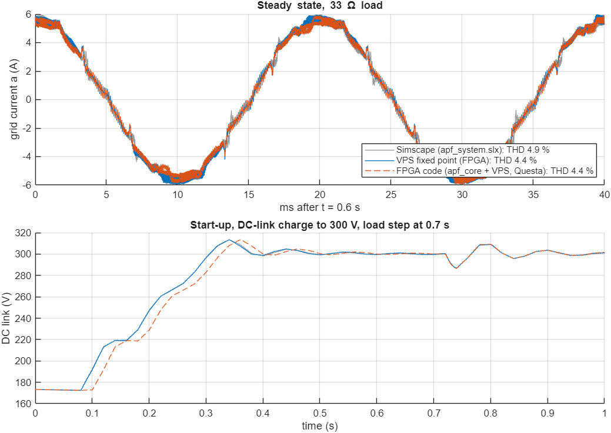

# H3 progress: virtual power stage on the DE2-115

Goal: run the APF controller in closed loop **on the DE2-115 board with nothing connected**.
The grid, the diode-bridge load and the inverter are computed inside the FPGA (the "virtual power stage", VPS),
and the switches, LEDs, 7-segment displays and Signal Tap are used to run and watch it.
Decided with the user on 31 Oct 2026; the presentation format is still to be decided by the team.

| Step | What | Status |
|---|---|---|
| 1 | MATLAB/Simulink model of the VPS in fixed point, checked against the Simscape model | **done** |
| 2 | FPGA code for the VPS (+ ADC code converter), bit-exact against the MATLAB model; closed loop with `apf_core` in Questa | **done** |
| 3 | DE2-115 top level: Cyclone IV support in Quartus, timing on the real chip, pins from Terasic's list, switches/LEDs/7-seg, compile | in progress: Cyclone IV installed, timing fixed; top level next |
| 4 | Test on the board together with the user (Signal Tap instead of an oscilloscope) | waiting |

## Step 1 result (31 Oct 2026)

Files: `matlab/vps_params_H3.m` (the specification: number formats and integer constants),
`matlab/blocks/vps_block_H3.m` (one plant step, bit-exact reference), `matlab/build_apf_vps_H3.m`
(builds `apf_vps_H3.slx`: the unchanged controller of `apf_system.slx` + the VPS), `matlab/vps_check_H3.m`.

| Plant | Grid THD 33 Ω | Grid THD 22 Ω | Load THD (no APF) |
|---|---|---|---|
| Simscape (`apf_system.slx`) | 4.85 % | 3.59 % | 28.1 % |
| VPS fixed point (= FPGA math) | 4.43 % | 3.50 % | 26.1 % |
| VPS real numbers | 4.44 % | 3.53 % | 26.1 % |

- **Integer math is accurate:** before switching starts, the fixed-point and real-number versions differ by less than 1 mA and 0.4 mV. In closed loop, THD changes by at most 0.03 points.
- **Same as the H1 testbench:** the VPS uses the same equations as `sim/tb_apf_system.sv` and gives the same THD (4.40 / 3.50 %).
- **Known difference from Simscape:** the VPS approximates the diode-bridge commutation with a 0.2 ms lag, while Simscape simulates the 0.5 mH line reactor itself. That gives a squarer load current in Simscape (28 % against 26 % load THD), and that's why Simscape shows about 0.4 points more grid THD. A proper commutation model could be added later if the team wants a closer match.
- **Same startup:** PLL lock at 40 ms and switching from 80 ms in all three; no faults, no shoot-through.
- **Speed:** a 1 s run takes about 70 s in Simulink (5 million plant steps). On the FPGA it runs in real time.

## Step 2 result (31 Oct 2026)

Files:

| File | What it is |
|---|---|
| `rtl/virtual_power_stage_H3.sv` | the plant in FPGA code: one step every 10 clocks, same integers as `vps_block_H3.m` |
| `rtl/vps_adc_H3.sv` | stands in for the ADC: takes the 7 codes at `adc_start`, delivers them 20 us later, optional ~1 count noise |
| `rtl/apf_vps_system_H3.sv` | `apf_core` + VPS + ADC stand-in: everything the board will run; the DE2-115 top level only wraps it |
| `matlab/vps_vectors_H3.m`, `matlab/vps_adc_codes_H3.m` | 40 ms of test inputs (PWM, connect/disconnect, a forced shoot-through, load step, gates off) and the expected outputs from the MATLAB model |
| `sim/tb_vps_H3.sv` | compares the FPGA code with the MATLAB model, every output at every step |
| `sim/tb_apf_vps_H3.sv` | closed loop, 1 s: run request at 10 ms, load step at 0.7 s, ADC noise on |
| `sim/run_vps_H3.do` | runs both testbenches; then `vps_rtl_check_H3` in MATLAB compares the closed loop with Simulink |

**Bit-exact:** 200,000 plant steps (40 ms) with **0 mismatches** on all 21 outputs.
That covers grid voltages, all currents, Vdc, the 7 ADC codes, and the shoot-through counter.

**Closed loop on the FPGA code (Questa):**

1 s, ADC noise on, run request at 10 ms, load step at 0.7 s. The Questa run takes about 9.5 min.

| Plant | Grid THD 33 Ω | Grid THD 22 Ω | Vdc dip at load step | PLL lock | Switching from | Faults |
|---|---|---|---|---|---|---|
| Simscape (`apf_system.slx`) | 4.85 % | 3.59 % | 13.3 V | 39.9 ms | 80.0 ms | none |
| VPS fixed point, Simulink | 4.43 % | 3.50 % | 13.3 V | 39.9 ms | 80.0 ms | none |
| **FPGA code (`apf_core` + VPS), Questa** | **4.40 %** | **3.51 %** | 13.7 V | 40.0 ms | 80.2 ms | **none** |

DC link ends at 301.4 V (target 300 V). Shoot-through steps: 0.

- **The FPGA code behaves like the Simulink model.** THD differs by 0.03 points or less, and the load step at 0.7 s is the same.
- **One small timing difference at start-up:** the FPGA run starts switching 0.2 ms later. The DC-link loop in `current_controller.sv` only updates once per grid cycle, and that 0.2 ms seems to miss one update, so the FPGA charges the DC link one cycle (20 ms) later. From 0.4 s on the two curves lie on top of each other.
- The two testbenches (bit-exact and closed loop) were rerun on the final code, after the timing fix.

**Fit and timing** (on Cyclone V 5CSEMA5F31C6, the only Cyclone family installed right now):

| Item | Value |
|---|---|
| Setup slack at 50 MHz | **+2.98 ns** worst |
| Hold slack | +0.11 ns |
| Logic | 2,615 ALMs (8 %) |
| Registers | 2,810 |
| Block memory | 158 kbit (4 %) |
| DSP blocks | 67 / 87 (77 %) |

The first version failed timing by 2 ns: one path did the inverter voltages, the sum of
currents, a multiply and the Vdc update all in one clock. It now spreads them over three
extra clocks of the 10-clock step.

Both open questions from step 2 were answered on the real chip in step 3 (below).

## Step 3 progress (31 Oct 2026)

**Cyclone IV E support installed** (with the user's OK): `cyclone-25.1std.0.1129.qdz`, 466 MB, added to Quartus
Prime Lite 25.1std with the Device Installer. Quartus now knows the DE2-115 chip, EP4CE115F29C7.
`quartus/check_timing.ps1` takes `-Family 'Cyclone IV E' -Device EP4CE115F29C7` for it.

**First compile of `apf_vps_system_H3` on EP4CE115F29C7:** it fits easily, but setup timing failed at the hot corner.

| Check | Value |
|---|---|
| Logic elements | 8,140 / 114,480 (7 %) |
| Multipliers (9-bit elements) | 180 / 532 (34 %) |
| Memory bits | 158 kbit (4 %) |
| Setup slack, slow model 85 °C | **-1.43 ns** |
| Setup slack, slow model 0 °C | +0.63 ns |

The slow paths were each one long calculation done in a single clock:

| File | Calculation in one clock | Fix | Check after the fix |
|---|---|---|---|
| `rtl/current_controller.sv` | DC-link PI: ramp, error, integrator, clamp, command, clamp | split over `DC_LOOP`, `DC_INTEG`, `DC_CMD` | (runs once per grid cycle, so 2 extra clocks change nothing) |
| `rtl/srf_pll.sv` | PI, frequency clamp, angle advance | split over `LOOP`, `FREQ`, `ADVANCE` (87 clocks per frame instead of 85) | PLL test: 11,000 frames bit-exact against `model/pll_model.py` |
| `rtl/virtual_power_stage_H3.sv` | load phase current update: subtract, multiply, round, add | the part without `idq` moves to ph 7, and the rounding constant is folded into the add | VPS test: 200,000 steps, 0 mismatches |

Same math, same rounding, so the results don't change, only when each part is computed.

**After the fix, on EP4CE115F29C7:**

| Check | Value |
|---|---|
| Setup slack, slow 85 °C | **+1.93 ns** |
| Setup slack, slow 0 °C | +3.63 ns |
| Setup slack, fast 0 °C | +11.38 ns |
| Hold slack (worst) | +0.14 ns |
| Logic elements | 8,214 (7 %) |
| Multipliers | 184 / 532 (35 %) |

**Same results after the fix:** the 1 s closed-loop run (`sim/tb_apf_vps_H3.sv`) gives a CSV that is
byte-for-byte identical to the one before the fix (SHA1 `865b612e...`). `vps_check_H3` and `vps_rtl_check_H3`
were rerun in MATLAB, with the same numbers as in step 2.

Next: the DE2-115 top level (switches, LEDs, 7-segment displays, Terasic pin list).

**THD meter, part 1: the math in MATLAB** (`matlab/thd_meter_H3.m`, `matlab/thd_table_H3.m`). The right display of the
board will show the THD of grid current a, computed in the FPGA from the 10 kHz frame samples:

- every 1000 samples (0.1 s, 5 grid cycles), a DFT of harmonics 1..40 with a 200-point cos/sin table scaled 2^15
  (the virtual grid is exactly 50 Hz and a frame is exactly 1/200 of a cycle, so the table index is `(h*k) mod 200`)
- THD = sqrt(sum |I_h|^2, h = 2..40) / |I_1|, the same definition as the FFT THD used everywhere else
- whole numbers only: samples cut to 2^-10 A, sums rounded by 2^16, a 24-step division and an integer square root,
  output in 0.01 % (440 = 4.40 %); no reading when the fundamental is below about 0.1 A

A first version used the RMS of the whole signal instead of single harmonics. It read too high (5.2-5.4 % instead
of 4.4 %), because it also counted harmonics above 40 from the commutation notches, so it was dropped.

| Window of the 1 s run | Meter, filter on | FFT h2-40 | Meter, filter off | FFT h2-40 |
|---|---|---|---|---|
| 0.5-0.6 s (33 ohm) | 4.35 % | 4.44 % | 26.06 % | 26.11 % |
| 0.6-0.7 s (33 ohm) | 4.41 % | 4.49 % | 26.06 % | 26.11 % |
| 0.9-1.0 s (22 ohm) | 3.27 % | 3.50 % | 26.00 % | 26.06 % |

On known test signals (harmonics up to 40) the meter is within 0.03 points of the exact THD. It is section 5 of
`run_H3` in the user's MATLAB folder. Next: `rtl/thd_meter_H3.sv`, bit-exact with this MATLAB code.

**Part 2: board code.**

| File | What it does |
|---|---|
| `rtl/thd_meter_H3.sv` | the THD meter: 3 clocks per harmonic per sample, 40 sums in one RAM, then powers, a 24-step division and a 14-step square root (about 330 clocks after the last sample of a window; samples come every 5000) |
| `rtl/thd_table_200.hex` | its cos/sin table, written by `matlab/thd_vectors_H3.m` |
| `rtl/apf_vps_system_H3.sv` | now also holds the meter, sampling grid current a (`il - i_inv`) on `adc_start`, and the peak grid current over the same 0.1 s |
| `rtl/display_H3.sv` | the 8 digits: DC link in whole volts on the left, one reading on the right; binary to decimal by double dabble, values refreshed every 0.2 s |
| `rtl/de2_115_top_H3.sv` | the board level: KEY0 reset (also at power-up), SW0..SW4 synchronized and debounced (10 ms), LEDs, displays |

Two changes to the agreed layout, both forced by the board:
- **No decimal point.** The DE2-115 digits have only the 7 segment pins (Terasic's pin list has `HEX0[0..6]` ...
  `HEX7[0..6]`, no dot). The decimal point is shown as a bottom bar in its own digit: `4_40` = 4.40 %, `26_1` =
  26.1 % (from 10 on there is room for one decimal, rounded), `50_0` = 50.0 Hz. The DC link is shown in whole volts (` 301`).
- **Four right-display choices, not five.** SW4..SW3 give 4 settings: 00 THD, 01 PLL frequency, 10 peak grid
  current, 11 shoot-through count. The fault code is already on LEDR3..0, so it has no display setting.

**Part 3: pins.** `quartus/de2_115_pins_H3.tcl` holds the 106 pins the design uses (CLOCK_50, KEY, SW, LEDG,
LEDR, HEX0..7), copied with their I/O standards from Terasic's `DE2_115.qsf` (made by the Terasic System Builder).
Every pin matched a second, independent DE2-115 project file (106 of 106) and a third (28 of 28).
`quartus/build_de2_115_H3.ps1` makes the project, sets every unused pin to "As input tri-stated", compiles,
and checks the pin report.

| Check (EP4CE115F29C7, whole board design) | Value |
|---|---|
| Logic elements | 10,098 / 114,480 (9 %) |
| Multipliers (9-bit elements) | 221 / 532 (42 %) |
| Memory bits | 168 kbit (4 %) |
| Setup slack, slow 85 °C / slow 0 °C / fast 0 °C | +1.77 / +3.51 / +11.24 ns |
| Hold slack (worst) | +0.13 ns |
| Outputs | 83: LEDG, LEDR and HEX only (plus the chip's own configuration/JTAG pins) |
| Unused pins | As input tri-stated |
| Build time | about 1 minute |

**Part 4: tests** (`sim/run_board_H3.do`, then `board_check_H3` in MATLAB):

| Test | Result |
|---|---|
| `tb_thd_meter_H3`: FPGA meter vs `thd_meter_H3.m`, 14 signals (clean, APF on/off, too small, over 100 %, 30 A, noise, h = 45) | 14 of 14 readings identical |
| `tb_display_H3`: every reading 0..9999 in every format, every DC-link code | 60,000 checks, 0 wrong |
| `tb_de2_115_H3`: the board top level with the demo sequence on KEY0 and the switches, 1.13 s | 16 of 16 checks OK (12 min) |
| `board_check_H3`: the board's THD readings recomputed in MATLAB from the samples the board took | 11 of 11 identical |

What the board shows in that simulation (left: DC link in V; right: grid THD, `_` = decimal point):

| Time | Display | LEDG 3..0 | What is happening |
|---|---|---|---|
| 0.05 s | ` 172 ----` | 0001 | PLL locked, DC link at the 173 V precharge, no reading yet |
| 0.15 s | ` 202 22_4` | 0111 | switching since 80 ms; first reading (0-0.1 s, mostly before the filter started) |
| 0.25 s | ` 253 2_74` | 0111 | DC link charging to 300 V |
| 0.65 s | ` 299 4_41` | 0111 | steady state, 33 ohm |
| 0.62 s, SW4..3 = 01 / 10 / 11 | `50_0` / `6_10` / `   0` | | PLL frequency, peak grid current, shoot-through count |
| 0.75 s | ` 291 4_53` | 1111 | SW1 up at 0.7 s: 22 ohm, the DC link dips and recovers |
| 0.95 s | ` 295 14_8` | 1011 | SW0 down at 0.85 s: filter off (this reading is half on, half off) |
| 1.05 s | ` 294 26_0` | 1011 | filter off: the grid carries the load current, 26 % THD |
| after KEY0 | ` 173 ----` | 1000 | reset: back to the precharge; LEDG3 stays on because SW1 is still up |

No faults and no shoot-through at any time. Found while testing: during reset `adc_start` (the PWM
`frame_start`) is high on every clock. Harmless, because the meter is held in reset too, but a testbench
that logs samples has to skip the reset.

**Part 5: waveform recording on the board.** Instead of Signal Tap, the design records into its own on-chip
memories, which the PC reads over the USB-Blaster cable while the design runs (In-System Memory Content
Editor, scripted). Signal Tap would need a hand-written .stp file and its GUI for every capture; this way one
MATLAB command reads the board and plots.

| File | What it does |
|---|---|
| `rtl/capture_H3.sv` | records grid, load and inverter current a, DC link and grid voltage a at the meter's sample instants (10 kHz) into a ring of 16384 samples. Flipping SW0..SW2 lets it record 8192 more and stop (0.82 s before and after); LEDG8 then lights. KEY1 starts a new recording. Six JTAG-readable memories: IG, IL, II, VD, VG and INF (status, trigger address, the THD meter's window position) |
| `quartus/read_capture_H3.tcl` | `quartus_stp` script: finds the USB-Blaster and the EP4CE115, reads the six memories, writes them in address order |
| `matlab/load_capture_H3.m` | turns the files into time-aligned signals in A and V, and the meter's window starts |
| `matlab/capture_check_H3.m` | checks the recordings of the board simulation against the samples the meter took |
| `Desktop\matlab\4_Board_Test_H3\run_board_H3.m` | the user's Live Script: reads the board (or shows the simulated recordings), plots against the Questa run, and lists the THD the display showed |

With the recorder: 10 % of the logic, 37 % of the memory bits (1.48 Mbit), setup slack +2.19 ns at 85 °C.
The JTAG data pin is then called `altera_reserved_tdo` in the pin report (still the chip's own JTAG pin).

Next: step 4 on the board.

## Notes for whoever continues

- The VPS takes one step every 200 ns (10 clocks at 50 MHz). Every product is rounded with
  `(x + (1 << (s-1))) >>> s`, and every product stays below 2^53, so MATLAB doubles match the FPGA exactly.
- The cosine table is `rtl/cos_table_4096.hex`: 4096 points per turn, peak 65536, stored as 5 hex digits of which the FPGA keeps the low 18 bits.
- After any MATLAB batch run, check for leftover MATLABWindow processes.
