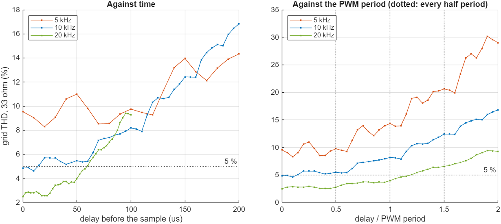

# HEX4 progress: board test, delay steps, real-hardware path

Done 6 Nov 2026, overnight, with no one at the PC. **Nothing here has run on a real board or touched real hardware.**
The H3 design and its `.sof` are unchanged. The new real-hardware design is separate.

| Part | Status |
|---|---|
| Guided board test, `5_Board_Test_HEX4\run_board_HEX4.m` | written; 8 of 13 situations tested against a fake board |
| Read path over the USB cable, `quartus/read_capture_HEX4.tcl` | 19 of 19 against a fake Quartus, on a full 16384-sample recording; real Quartus tried with no board only |
| Full switch sequence in simulation | **not finished:** stopped at 2.0 s of 4.77 s, because the PC ran low on memory |
| The 50 us THD steps | answered: they follow the PWM, not a fixed time (clean at 5 and 10 kHz, blurrier at 20 kHz) |
| Real-hardware design: AD7606 driver, gate safety, header pins | built and passing in simulation; **ready if the team approves this ADC and these sensors** |

## 1. Guided board test

Files: `Desktop\Randos\matlab\5_Board_Test_HEX4\run_board_HEX4.m` (the user's one file), `quartus/read_capture_HEX4.tcl`.

The script loads the design, says which switch to flip, sees when each recording is ready, reads it, and gives a
pass/fail table. Every step goes to `session_log.txt`.

**What changed in the read script.** The status memory `INF` is rewritten every clock while JTAG reads it on another
clock, and a read during a write can return garbage. The script now votes on each word, and it reads `INF` again after
the channels and rejects the recording if it changed.

| Test | Result |
|---|---|
| `matlab/read_path_check_HEX4.m`, the real read script against `sim/mock_quartus_HEX4.tcl`, full 16384-sample recording | **19 of 19**, including 12 of 12 collision seeds bit for bit |
| The same with the voting removed on purpose | caught: wrong recording in 10 of 12 runs |
| `matlab/board_flow_check_HEX4.m`, the user's script unchanged except for `source`, with fake Quartus programs | **8 of 13 run, 8 passed**. The expected outcome of each of the 13 is listed in the file |
| Recording 1 against the script's own absolute limits | 11 of 11 inside the limits |

The 5 situations not run (`normal`, `switch_up_at_load`, `wrong_switch`, `bad_order`, `dead_apf`) need all 3 recordings.
So **a complete good run through the guided script has not been tested yet.**

**A real bug this found:** MATLAB's `tempdir` ends in a backslash, so `"...\Temp\"` swallowed the closing quote on the
Windows command line. The first status read of every real board run would have failed. Fixed.

## 2. Full switch sequence

`sim/tb_board_sequence_HEX4.sv` runs the exact board design through the switch sequence: SW0 up at 1.0 s, KEY1 at 2.0 s,
SW1 up at 2.5 s, KEY1 at 3.4 s, SW0 down at 3.9 s, end at about 4.77 s.

It was stopped at 2.0 s when the PC ran low on memory, with the 246-run delay rerun going at the same time. Recording 1
finished and its checks passed: 8192 samples each side of the switch, 26.1 % THD before, 4.61 % after, DC link 300.1 V.
Recordings 2 and 3 do not exist yet.

To finish, with nothing else heavy running (about 1.5 hours):

```tcl
vsim -c -do sim/run_board_sequence_HEX4.do
```
Then copy `sim/out/HEX4/rec1_sw0_up`, `rec2_sw1_up` and `rec3_sw0_down` to `5_Board_Test_HEX4\support\expected`, and run
`board_flow_check_HEX4` on that folder.

Until then the guided script still runs on the board. It leaves out the 3 comparison checks per recording, and says so.

## 3. The 50 us THD steps

Question from H2: THD rises in steps about every 50 us of sensor delay. Half the PWM period is also 50 us, but that was
never tested. **Test:** change the PWM frequency and nothing else. 246 Simulink runs, 5/10/20 kHz, 2 noise seeds, 0 faults.
Script: `Desktop\Randos\matlab\6_Delay_Steps_HEX4\run_delay_steps_HEX4.m`.



| PWM | Seed-to-seed correlation of the bumps | Energy at 2 / 4 / 8 cycles per sweep | Rises at (PWM periods) |
|---|---|---|---|
| 5 kHz | 1.00 | 6 / 36 / 39 % | 0.20, 0.45, 0.65, 0.90, 1.20, 1.40, 1.65, 1.90 |
| 10 kHz | 0.99 | 0 / 48 / 33 % | 0.20, 0.50, 0.70, 1.15, 1.40, 1.65, 1.90 |
| 20 kHz | 0.97 | 1 / 18 / 7 % | 0.25, 0.55, 0.75, 0.90, 1.05, 1.25, 1.80 |

- **The steps are real:** they repeat with another noise seed.
- **They follow the PWM.** At 5 and 10 kHz they land on the same fractions of the period, a factor of 2 apart in microseconds.
- **A fixed 50 us is ruled out:** at 20 kHz it predicts 2 cycles per sweep, and only 1 % of the energy is there.
- **20 kHz is not fully explained.** Its bumps are real but small, and its energy spreads over 3 to 5 cycles.
- **The mechanism is not proven.** PWM ripple sampled away from the carrier boundary is the likely reason. This test
  shows the tie to the PWM, not that mechanism.
- **Disclosure:** my first alignment score was inconclusive at 20 kHz, and I added the spacing comparison after seeing that.

**The full rerun with the final script was not finished** (stopped for low memory). 2 runs re-simulated with it match the
saved results to 6 decimals.

**For the team: the PWM frequency matters more than the sensors.**

| PWM | Grid THD, no extra delay, 33 ohm | Delay under 5 %, 33 ohm | Delay under 5 %, 22 ohm |
|---|---|---|---|
| 5 kHz | 9.54 % | none | none |
| 10 kHz (today) | 4.85 % | up to 10 us | up to 65 us |
| 20 kHz | 2.50 % | up to 57.5 us | up to 77.5 us |

These are model results with placeholder power-stage values. Switching losses are not modelled, and `rtl/thd_meter_H3.sv`
and the other 200-point tables are sized for 10 kHz. This is a team decision, not a change to make quietly.

## 4. Real-hardware design

`apf_core` is unchanged. **Sensors and ADC are the team's decision, so this is ready if approved, nothing more.**

| File | What it does |
|---|---|
| `rtl/ad7606_if_HEX4.sv` | runs the AD7606 in parallel mode; faults on BUSY stuck, BUSY never rising, FRSTDATA wrong, start while busy; a frame with bad FRSTDATA is not delivered |
| `rtl/adc_scale_HEX4.sv` | 16-bit counts to `apf_core`'s 12-bit codes, with calibration gain and offset per channel |
| `rtl/gate_guard_HEX4.sv` | the last block before the gate pins; it can only turn gates off, and a trip stays until disarmed |
| `rtl/de2_115_hw_top_HEX4.sv` | the board level. SW17 arm, then SW0 run; LEDG3 armed; LEDR9..4 why it stopped |
| `quartus/de2_115_hw_pins_HEX4.tcl`, `build_de2_115_hw_HEX4.ps1` | header pins, build, and pin checks |
| `matlab/frontend_sizing_HEX4.m` | sensor resistors for the +-10 V range (LV 25-P can only reach 6.65 V, hence the digital gain) |
| `sim/ad7606_model_HEX4.sv` | the ADC at its pins, enforcing the data sheet's timing limits, with fault injection |

**Build on EP4CE115F29C7:** 9,199 logic elements (8 %), 141 of 532 multipliers, 1.41 Mbit of memory.
Setup slack +3.91 / +5.44 / +12.10 ns (slow 85 C, slow 0 C, fast 0 C), hold +0.30 / +0.31 / +0.11 ns. 99 user outputs, 16 on
the header, none outside the plan, unused pins are inputs. The `.sdc` sets the ADC and gate I/O as false paths, so
their timing is checked in simulation, not by the timing analyzer.

**Tests** (`sim/run_hw_HEX4.do`):

| Test | Result |
|---|---|
| `fast`: driver against the data-sheet model, 11 cells (typical, fastest, slowest, 2.7 V, and every injected fault) | 11 of 11 |
| `fast`: guard, 5 rules on every clock, directed and 400,000 random clocks | 0 failed |
| `fast`: guard with each of 7 rules removed on purpose | all 7 caught |
| `safety`: every fault staged on the running inverter, full design | 32 of 32 |
| `loop`: 1 s closed loop, every code checked against the plant | 6 of 6, 9,999 frames, **0 wrong** |
| `chain`: 30 ms of the loop test, with a wrong scale gain and with shifted channels | good design passes, both copies caught |

| Fault staged | Pins off after |
|---|---|
| Gate driver reports a fault | 120 ns |
| BUSY never rises | 200 ns |
| FRSTDATA wrong | 4.2 us |
| Sensor out of range | 5.1 us |
| BUSY stuck high | 5.2 us |
| No ADC frames (watchdog, 300 us) | 205 us |

**Closed loop against H3** (`matlab/hw_chain_check_HEX4.m`, limits set before the first comparison):

| Measure | Real-hardware design | H3 design | Allowed |
|---|---|---|---|
| Grid THD 33 ohm | 4.37 % | 4.40 % | 0.25 points |
| Grid THD 22 ohm | 3.51 % | 3.51 % | 0.25 points |
| DC-link dip at the load step | 13.73 V | 13.65 V | 1 V |
| PLL lock | 40.01 ms | 40.03 ms | 1 ms |
| Switching from | 80.21 ms | 80.21 ms | 21 ms |
| DC link at the end | 301.40 V | 301.42 V | 1 V |
| Faults | none | none | none |

**What the tests found:**
- The test script stopped after the first `$finish`, so the guard tests had silently not run. Fixed with `-onfinish stop`.
- Disarming reached the gate buffer one clock late (20 ns). Fixed in the guard, with a broken copy (`disarm_acts_late`) to keep it fixed.
- 3 wrong test expectations, one a race on `arm` and two checks stricter than the design's intent. Each was changed with its
  reason, not to get a pass: `tb_gate_guard_HEX4` now samples what the guard saw at the clock edge.
- The random phase never turned both switches on from idle in one clock. Added. The broken shoot-through copy then breaks rule 1 18,795 times.

**The hardware must add these, because the FPGA's weak pull-ups are on during configuration and cannot be turned off** (the gate
lines float high while it loads):
1 kOhm pull-downs on the gate lines and CONTACTOR; a 74HCT244-type buffer with GATE_EN_N on its enable and a pull-up to 3.3 V;
a 10 kOhm pull-down on DRIVERS_OK at the header. The wiring table and the order of first-power steps are in
`7_Real_Hardware_HEX4\run_real_hardware_HEX4.m`.

**What simulation cannot show:** real noise on the ADC lines, cable delays, ringing on the gate lines, and how the real
inverter behaves.

## Rerun

```tcl
vsim -c -do "set which fast; do sim/run_hw_HEX4.do"      # ~3 min
vsim -c -do "set which safety; do sim/run_hw_HEX4.do"    # ~6 min
vsim -c -do "set which loop; do sim/run_hw_HEX4.do"      # ~16 min
vsim -c -do "set which chain; do sim/run_hw_HEX4.do"     # ~2 min
```
This Questa license allows one simulation at a time on the PC.
```matlab
hw_chain_check_HEX4
read_path_check_HEX4('..\sim\out\HEX4\rec1_sw0_up')
board_flow_check_HEX4('...\Desktop\Randos\matlab\5_Board_Test_HEX4', {'no_cable','pgm_fails'})
```
```powershell
.\quartus\build_de2_115_hw_HEX4.ps1   # ~1.5 min
```

## Sources

- [AD7606 data sheet, Rev. G](https://www.analog.com/media/en/technical-documentation/data-sheets/AD7606_7606-6_7606-4.pdf): timing limits (Table 3) and pin settings
- [DE2-115 User Manual](https://www.cl.cam.ac.uk/teaching/1213/ECAD+Arch/labs/files/DE2_115_User_manual.pdf): header JP5, Figure 4-15. All 36 GPIO pins also agree with 3 independent project files
- Intel on weak pull-ups during configuration: [article 000074237](https://www.intel.com/content/www/us/en/support/programmable/articles/000074237.html), [article 000085785](https://www.intel.com/content/www/us/en/support/programmable/articles/000085785.html), [Altera knowledge base](https://community.altera.com/kb/knowledge-base/when-are-the-internal-weak-pull-up-resistors-enabled-during-power-up-for-cyclone/340858)
- [Altera forum post](https://community.altera.com/discussions/quartus-prime/state-of-fpga-pins-before-bitmap-takes-effect/225901) for the pull-up range of about 7k to 352k. This is a forum post citing the data sheet's table, so check the value before relying on the pull-down size
