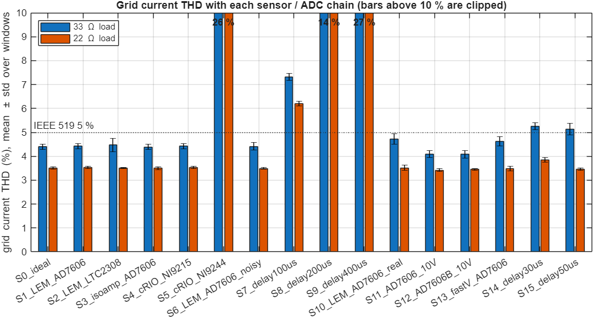
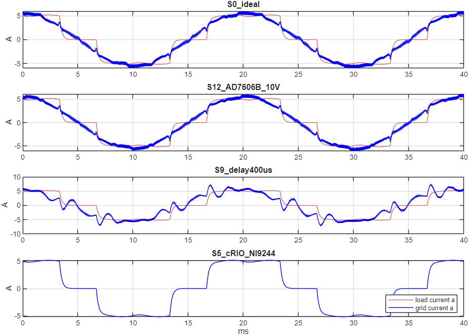
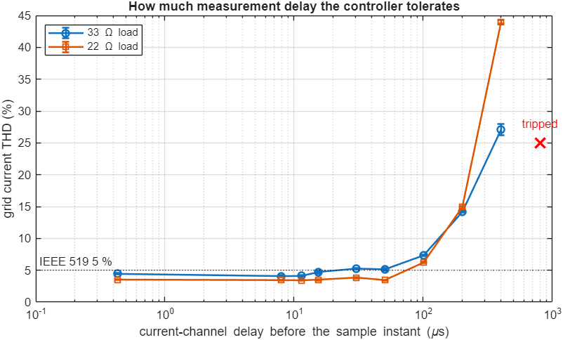

# H1: sensors and ADC for the DE2-115 (30 Oct 2026)

The real board is a **Terasic DE2-115** (Cyclone IV E, EP4CE115F29C7), not the DE1-SoC.
The DE2-115 has no ADC that can measure 50 Hz signals (its only converter is an audio codec),
so the APF needs an external ADC and sensors. The lab also has an **NI cRIO-9063**
(Zynq-7020, 4 C Series slots, RS-232). This study picks the sensors and the ADC, and decides
what the cRIO should do. The choice is pending the professor's feedback.

**Method.** Every option was simulated in closed loop with the real FPGA design
(`apf_core` RTL) and the same virtual power stage as `tb_apf_system.sv`. The new testbench
`sim/tb_apf_system_H1.sv` puts a measurement chain between the plant and the ADC codes:
- sensor bandwidth (first-order lag per channel type),
- pure delay before the sample (for example an ADC's anti-alias filter),
- sequential sampling skew (multiplexed ADC),
- the time the codes take to reach the FPGA,
- noise.

With no options it is exactly the old testbench. Scenario S0 reproduces the old run
**bit for bit**, which was checked over all 100,000 logged rows.

Timing values come from the datasheets:

| Part | Datasheet figure | Value used |
|---|---|---|
| LEM LA 25-NP (current) | delay to 90 % < 1 us, bandwidth DC-150 kHz | tau 0.43 us |
| LEM LV 25-P (voltage) | 40 us to 90 %, an L/R constant quoted at R1 = 25 kOhm (primary about 0.44 H) | grid channel R1 = 10 kOhm: tau 42.8 us; DC link R1 = 30 kOhm: tau 14.5 us |
| AD7606, +-5 V range | 2nd-order on-chip filter, 15 kHz, group delay 15 us; 4 us conversion | delay 15 us |
| AD7606, +-10 V range | group delay 11 us | delay 11 us |
| AD7606B, +-10 V range | phase delay 7.5 us | delay 7.5 us |
| LTC2308 | 8 channels multiplexed, about 2 us per channel | skew 2 us |
| NI 9244 / 9246 (cRIO) | delta-sigma, input delay (40 + 5/512)/fs + 1.7 us | 0.80 ms at 50 kS/s |
| NI 9215 (cRIO) | 4 ch simultaneous, 10 us conversion | plus a digital link to the DE2-115 (assumed 35 us total) |

**THD measurement.** For each load, the grid current THD is the mean of every 5-cycle window in
steady state: windows starting 0.40-0.60 s for 33 ohm, and 0.80-0.90 s for 22 ohm.
A single window, as used in the README table, varies by about +-0.1-0.3 points.

## Results

| Scenario | Grid THD 33 ohm | Grid THD 22 ohm | Result |
|---|---:|---:|---|
| S0 ideal sensors, 12-bit ADC (old testbench) | 4.40 % | 3.50 % | OK |
| S1 LEM + AD7606, sensor lag at datasheet test condition | 4.43 % | 3.53 % | OK |
| S2 LEM + LTC2308 (multiplexed) | 4.48 % | 3.51 % | OK, +-0.28 spread (worst) |
| S3 isolated-amplifier voltage + LA 25-NP + AD7606 | 4.39 % | 3.50 % | OK |
| S4 LEM + cRIO NI 9215, codes arrive 35 us after the sample | 4.43 % | 3.53 % | OK |
| **S5 cRIO NI 9244/9246 delta-sigma (0.8 ms)** | 26.1 % | 26.1 % | **trips (over-current + measurement), Vdc collapses** |
| S6 as S1 with 3x the ADC noise | 4.41 % | 3.49 % | OK |
| S7 as S1 + 100 us delay before the sample | 7.32 % | 6.20 % | above 5 % |
| S8 as S1 + 200 us | 14.1 % | 14.9 % | poor |
| S9 as S1 + 400 us | 27.1 % | 44.0 % | worse than no APF |
| S10 LEM + AD7606 +-5 V range, every real lag | 4.72 % | 3.51 % | OK, closest to 5 % |
| **S11 as S10 on the AD7606 +-10 V range** | **4.10 %** | **3.42 %** | **best** |
| **S12 as S10 with AD7606B, +-10 V range** | **4.08 %** | **3.45 %** | **best** |
| S13 as S10 with a fast (1 us) grid-voltage sensor | 4.62 % | 3.48 % | OK |
| S14 as S1 + 30 us delay before the sample | 5.26 % | 3.85 % | just above 5 % at 33 ohm |
| S15 as S1 + 50 us | 5.14 % | 3.45 % | just above 5 % at 33 ohm |

Without the APF, the load current THD is 26.1 %. No scenario had shoot-through.
Except S5, every scenario holds Vdc at 300 V and dips about 13 V at the load step.

**Repeatability.** S0, S10 and S11 were run again with a different noise seed (`+SEED=777`).
The results moved by 0.04 points at most (S0 4.39 / 3.49 %, S10 4.69 / 3.53 %, S11 4.06 / 3.45 %).
So differences of about 0.2 points or more between scenarios are real, not chance.

### What the results show

1. **Only delay *before* the sample instant matters.** The ADC samples on the PWM carrier
   boundary. When the codes then arrive does not matter, as long as it is inside the 100 us frame:
   S1 (8 us) and S4 (35 us) give identical results. So a slow serial link is fine.
2. **How much delay before the sample is acceptable:**
   - Up to about 15 us, THD stays at 4.1-4.7 % (33 ohm) and 3.4-3.5 % (22 ohm).
   - At 30-50 us it is 5.1-5.3 % at 33 ohm, just over 5 %.
   - At 100 us it is 7.3 %, and beyond that it gets much worse.

   Below 50 us the curve is not monotonic (for example 50 us came out slightly better than 30 us),
   so treat **about 15 us as the safe budget** and 50 us as the edge.
   Delta-sigma ADCs (cRIO NI 9244/9246, about 0.8 ms) cannot close the current loop.
   They are good for power-quality measurement, not for control.
3. **The AD7606 filter is the largest real delay.** On the +-5 V range it adds 15 us, costing 0.3-0.6
   points. On the +-10 V range it adds 11 us. The same sensors and burden resistors are used,
   so the signals fill half the range and 15 bits are left. That is still 8x finer than the 12-bit
   codes `apf_core` uses. +-10 V gives the best result (S11, S12).
4. **The LV 25-P's 43 us lag on the grid voltage costs only about 0.1 point** (S10 vs S13).
   The PLL and the voltage feed-forward tolerate it, so a faster isolated amplifier is not needed.
5. **Noise is not a concern**: 3x the noise changes nothing (S6).
6. **Simultaneous sampling is a little better than multiplexed** (S2 vs S1), but both are well under 5 %.
7. Small delays (8-11 us) came out slightly *better* than zero delay (4.1 % vs 4.4 % at 33 ohm),
   and 50 us slightly better than 30 us. The controller's response to delay is not a simple
   threshold. It probably interacts with the one-frame prediction in `current_controller`, but
   this is not confirmed. Explaining it, and possibly adding a deliberate delay compensation,
   is a candidate for a later run (H2).

## Recommendation

**Sensors (7 channels, same as `apf_core` expects):**

| Channel | Part | Qty | Primary | Burden RM (E96) | Full scale at the ADC | Notes |
|---|---|---:|---|---|---|---|
| Grid voltage a, b (phase to neutral) | LEM LV 25-P | 2 | R1 = 10 kOhm, >= 2.5 W | 162 Ohm | +-128 V -> +-5 V | needs the neutral; without it, measure line-line and convert in the FPGA |
| DC link | LEM LV 25-P | 1 | R1 = 30 kOhm, >= 10 W (e.g. 3 x 10 kOhm 5 W) | 147 Ohm | 0-410 V -> 0-5 V | 300 V gives the nominal 10 mA |
| Load current a, b; inverter current a, b | LEM LA 25-NP, 1 primary turn | 4 | - | 243 Ohm | +-20.5 A -> +-5 V | trip at 15 A is inside the range |

All values are inside LEM's limits for a +-15 V supply. The script `matlab/frontend_sizing_H1.m`
recomputes them from the scaling in `apf_core` (16 counts/V, 100 counts/A, 10 counts/V) and checks
each datasheet limit. Rerun it if the grid voltage changes.
**A 230 V grid would also need a new KV inside `apf_core`**: the current scaling's full scale is
128 V peak, and the script flags this.

**ADC: AD7606B (or AD7606) module, RANGE pin high (+-10 V), serial output, VDRIVE = 3.3 V.**
- 8 simultaneous 16-bit channels: 7 used, 1 spare.
- About 4 us conversion, then 8 x 16 bits read as 64 clocks on each of DOUTA and DOUTB at 12.5 MHz:
  codes reach the FPGA about 10 us after the carrier boundary.
- 7 FPGA pins: CONVST, CS, SCLK, DOUTA, DOUTB, BUSY, RESET. RANGE and OS are set with jumpers.
- Set the module's logic supply (VDRIVE/VIO) to **3.3 V**. Many cheap modules default to 5 V,
  and the Cyclone IV E pins are not 5 V tolerant. Keep the DE2-115 GPIO header's I/O voltage
  jumper at 3.3 V (see the expansion-header section of the DE2-115 user manual).
- The FPGA adapter converts to the 12-bit codes `apf_core` expects:
  `code12 = (raw16 >>> 3) + 2048` for the bipolar channels and `raw16 >>> 2` for the DC link.
  It applies per-channel gain and offset calibration. The LA 25-NP offset (up to 0.15 mA = 0.15 A)
  must be measured at start-up, before switching, or the APF will inject DC current.

**Power:** +-15 V at about 0.3 A per rail for the 7 LEM sensors, and 5 V for the ADC module.

**DE2-115 GPIO (JP5, 36 I/O):** 7 for the ADC, 6 gate signals, about 2 for driver enable/fault.
That leaves about 20 spare.

**Role of the cRIO-9063.** It should not sit in the control loop.
- With NI 9244 + NI 9246/9247 (if installed), it is an **independent power-quality meter**.
  It can measure grid THD, harmonics and power factor without trusting the APF's own sensors,
  which makes good evidence for the thesis.
- It can log data and act as the operator panel (LabVIEW), sending start/stop and set-points to
  the DE2-115 over RS-232 (both boards have a DB9 port). This only needs a slow link.
- If no AD7606 can be bought, a cRIO with **NI 9215/9220** (SAR, simultaneous) plus an **NI 9401**
  can be the control ADC (S4 works). The cRIO must start each conversion on a trigger from the
  DE2-115 carrier boundary and send the codes back within the frame. This is more work than an AD7606 module.

**To confirm:** which C Series modules are in the lab's cRIO (the model number is printed on each module).

## Questions for the professor
1. Is the AD7606B (or AD7606) module with LEM LA 25-NP / LV 25-P acceptable, or does the lab already have other sensors?
2. Is the lab grid neutral available for the voltage sensors?
3. What grid voltage will the prototype use? The scaling is set for 100 V phase peak (lab scale).
4. Should the cRIO be the independent power-quality meter and operator panel?
5. Which THD limit applies: 5 % (IEEE 519, strictest row) or another target?

## Limits of this study
- Sensors are modeled as first-order lags with ideal gain. Gain and offset errors, EMI and saturation are not modeled.
- The AD7606 filter is modeled as its group delay, not the full 2nd-order response.
- The cRIO NI 9215 link time (35 us) is an assumption. It does not change the result unless it exceeds about 90 us.
- The power stage and controller are the existing lab-scale placeholders from `tb_apf_system.sv`.

## Files (H1)
| File | What it is |
|---|---|
| `sim/tb_apf_system_H1.sv` | system testbench with the measurement-chain options (`+TAU_V +TAU_I +TAU_DC +DELAY +SKEW +CONV +NOISE +SEED`) |
| `sim/run_sensor_study_H1.do` | runs all scenarios (about 5 min each; the free Questa license allows 1-2 at a time) |
| `matlab/sensor_adc_study_H1.m` | the table, figures and checks above (`matlab -batch "sensor_adc_study_H1"`) |
| `matlab/frontend_sizing_H1.m` | sensor resistor sizing and datasheet-limit checks |

## Sources
- LEM LA 25-NP datasheet, v17 (2022); LEM LV 25-P datasheet, v19 (2014)
- Analog Devices AD7606/AD7606-6/AD7606-4 datasheet (analog input filter table); AD7606B datasheet (phase delay)
- NI 9244 datasheet (input delay); NI 9215 specifications (conversion time)
- NI cRIO-9063 user manual; cRIO-906x getting started guide (from the lab)
