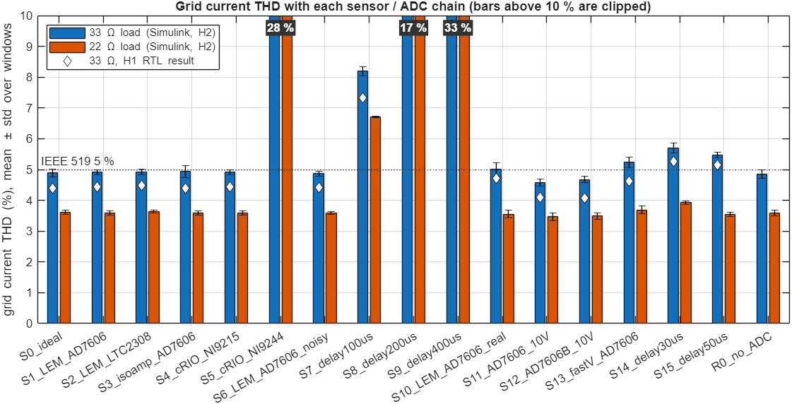
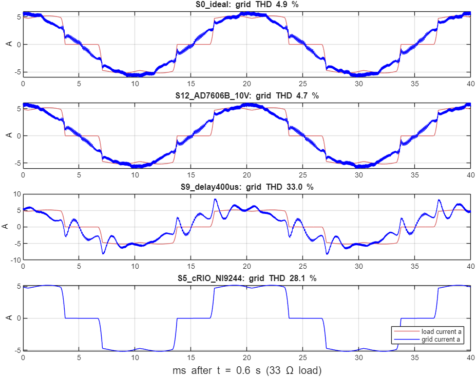
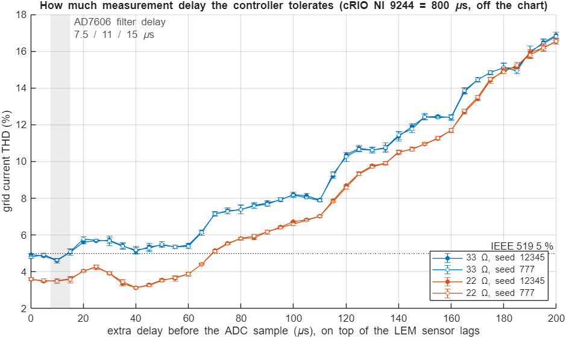

# H2: sensor and ADC study in Simulink (31 Oct 2026)

H1 ([sensor_adc_study_H1.md](sensor_adc_study_H1.md)) compared 16 sensor and ADC options in Questa,
using the `apf_core` RTL. H2 runs the same 16 options in MATLAB/Simulink, in the switching
model `apf_system.slx`. It also adds a fine sweep of the delay before the ADC sample.
Everything in H2 is MATLAB code and a Simulink model. To repeat it:

```matlab
cd matlab
sensor_adc_study_H2        % ~10 min for all 102 runs (5 in parallel), then table + figures
```

## Method

`build_apf_model_H2.m` copies `apf_system.slx` to **`apf_system_H2.slx`** and adds one block,
**"Sensors + ADC (H2)"**, between the power stage and the controller:

| Stage | What it models | Setting (`sensor_params_H2.m`) |
|---|---|---|
| Sensor lag | first-order lag per channel, computed every 0.5 µs | `tauV`, `tauI`, `tauDC` |
| Delay before the sample | ADC anti-alias filter group delay, delta-sigma filter | `delay` |
| Sample instant | simultaneous ADC, or multiplexed with `skew` between channels | `skew` |
| Delivery | codes reach the FPGA `conv` after the PWM carrier boundary | `conv` |
| 12-bit codes | same scaling as `apf_core` (16 counts/V, 100 counts/A, 10 counts/V), clamp, noise | `noise`, `seed`, `adc` |

The controller (PLL, reference and deadbeat current control) runs when the codes arrive.
Its duties still load at the next carrier boundary, the same timing as the FPGA.

The same run setup checks itself:

- **Same as the original model:** with an ideal ADC, `apf_system_H2` gives exactly the same waveforms as `apf_system.slx` (maximum difference 0).
- **Delivery time changes nothing:** moving only the delivery time from 0 to 8 µs also leaves the waveforms unchanged (difference 0).
- **Sensor block test:** the block gives the expected per-channel delays (22, 20 … 10 µs for a 10 µs filter delay plus 2 µs skew). It also gives the expected lag: 63 % after one time constant.

THD is measured the same way as in H1. It is the mean ± std of the grid current THD over every 5-cycle window from 0.40 to 0.60 s (33 Ω) and from 0.80 to 0.90 s (22 Ω).

## Results



| Chain | Grid THD 33 Ω | Grid THD 22 Ω | H1 (RTL) 33 / 22 Ω | Faults |
|---|---|---|---|---|
| S0 ideal sensors, 12-bit ADC | 4.89 ± 0.12 % | 3.61 ± 0.08 % | 4.40 / 3.50 | none |
| S1 LEM + AD7606 | 4.91 ± 0.08 % | 3.60 ± 0.07 % | 4.43 / 3.53 | none |
| S2 LEM + LTC2308 (multiplexed) | 4.91 ± 0.09 % | 3.63 ± 0.04 % | 4.48 / 3.51 | none |
| S3 isolated amplifier + AD7606 | 4.94 ± 0.20 % | 3.60 ± 0.07 % | 4.39 / 3.50 | none |
| S4 LEM + cRIO NI 9215 | 4.91 ± 0.08 % | 3.60 ± 0.07 % | 4.43 / 3.53 | none |
| **S5 cRIO NI 9244 (0.8 ms)** | **28.1 %** | **27.5 %** | 26.1 / 26.1 | **measurement + over-current, tripped** |
| S6 as S1, 3× noise | 4.87 ± 0.08 % | 3.58 ± 0.05 % | 4.41 / 3.49 | none |
| S7 S1 + 100 µs | 8.20 % | 6.71 % | 7.32 / 6.20 | none |
| S8 S1 + 200 µs | 16.9 % | 16.5 % | 14.1 / 14.9 | none |
| S9 S1 + 400 µs | 33.0 % | 49.2 % | 27.1 / 44.0 | none |
| S10 LEM + AD7606 ±5 V, real lags | 5.01 ± 0.22 % | 3.55 ± 0.12 % | 4.72 / 3.51 | none |
| **S11 AD7606 ±10 V** | **4.57 ± 0.11 %** | **3.47 ± 0.13 %** | 4.10 / 3.42 | none |
| **S12 AD7606B ±10 V** | **4.68 ± 0.10 %** | **3.49 ± 0.10 %** | 4.08 / 3.45 | none |
| S13 as S10, fast voltage sensor | 5.23 ± 0.16 % | 3.69 ± 0.12 % | 4.62 / 3.48 | none |
| S14 S1 + 30 µs | 5.70 % | 3.93 % | 5.26 / 3.85 | none |
| S15 S1 + 50 µs | 5.47 % | 3.54 % | 5.14 / 3.45 | none |
| R0 no ADC at all (= `apf_system.slx`) | 4.85 % | 3.59 % | | none |

Without the APF, the load current THD is 28.1 % (33 Ω). The full table is in
[sensor_adc_study_H2_results.csv](sensor_adc_study_H2_results.csv).

**Repeatability:** with noise seed 777 instead of 12345, S0 gives 4.88 %, S10 4.90 % and S11 4.69 % at 33 Ω, all within 0.12 points.

**Comparison with H1:** both studies rank the options the same way and reach the same conclusions. The
Simulink numbers are 0.3–0.6 points higher at 33 Ω because this load is a fully switched diode bridge
with a 0.5 mH line reactor, which distorts more: 28.1 % load THD here against 26.1 % in the H1 testbench.
Relative to the load, the APF removes about the same share of the harmonics in both.



In S5 the inverter trips, so the grid current equals the load current.

## Delay sweep: how much delay the controller tolerates

The sweep starts from S1 (LEM sensors with AD7606 timing) and adds 0–200 µs of delay before the sample in 5 µs steps, with two noise seeds.



- **Up to 10 µs costs nothing.** THD at 10 µs is 4.6 %, slightly below 0 µs (4.8–4.9 %). All the AD7606 options fall here: 7.5, 11 and 15 µs filter delay.
- **The 5 % limit at 33 Ω is passed at 15 µs** (5.1 %). From 20 to 60 µs THD stays on a plateau of 5.1–5.7 %, then jumps to over 7 % at 70 µs, 10 % at 120 µs and 17 % at 200 µs.
- **The 22 Ω load is more tolerant:** it stays under 5 % up to 65 µs.
- **The ups and downs are real, not noise.** The two seeds give the same curve to within about 0.1 point, so the dips (10 µs, 40 µs) and the steps (about 20, 65, 115 and 165 µs) come from the system itself. The steps repeat roughly every 50 µs, which is half the 100 µs PWM period. My explanation, not tested yet, is that it depends on where the sample lands on the inverter-current ripple: sampling at the carrier peak or valley gives the ripple-free average. Measuring the ripple at the sample instant would confirm it.

## What changes from H1

- **The ±10 V range matters more than H1 suggested.** In this model, only the two ±10 V options (S11 4.6 %, S12 4.7 %) are clearly under 5 % at 33 Ω. The ±5 V range (S10) sits right at the limit (4.9–5.0 %, depending on the seed). The recommendation is unchanged: LEM LA 25-NP + LV 25-P into an **AD7606B or AD7606 on the ±10 V range**.
- **The margin is small even with perfect sensors.** Ideal measurements already give 4.85 % at 33 Ω in this model. Better sensors can't buy more than a few tenths of a point. Larger gains would have to come from the power stage or controller (filter inductor, switching frequency, gains), which is worth raising with the professor.
- **No change on the cRIO:** the NI 9244/9246 delta-sigma modules still trip the inverter, so the cRIO stays a power-quality meter and HMI outside the control loop.
- **These options make no difference:** a multiplexed ADC (LTC2308), 3× ADC noise, the delivery time (S1 and S4 are identical), and the grid-voltage sensor speed (S10 vs S13, within ±0.2).

## Files (H2)

| File | Purpose |
|---|---|
| `matlab/build_apf_model_H2.m` | builds `apf_system_H2.slx` from `apf_system.slx` |
| `matlab/apf_system_H2.slx` | the model; open it, set `S = sensor_params_H2(...)`, press Run |
| `matlab/sensor_params_H2.m` | measurement-chain settings, with limits checked |
| `matlab/blocks/sensor_chain_block_H2.m` | sensor lag + delay + sample-instant code |
| `matlab/blocks/adc_quantizer_block_H2.m` | 12-bit codes, noise, conversion back to V and A |
| `matlab/sensor_adc_study_H2.m` | runs all 102 simulations, then the table, figures and H1 comparison |
| `docs/sensor_adc_study_H2_results.csv`, `docs/figures/H2_*.png` | results kept in git (`matlab/results/` is not) |

Example, running one chain by hand in MATLAB:

```matlab
cd matlab
S = sensor_params_H2('tauV', 42.8e-6, 'tauI', 0.43e-6, 'tauDC', 14.5e-6, 'delay', 7.5e-6, 'conv', 10e-6);  % S12
open_system('apf_system_H2')      % press Run, or: out = sim('apf_system_H2');
```

## Limits

- The controller is the floating-point Simulink model of the RTL, not the RTL itself. H1 checked the RTL with the same chains and gave the same ranking.
- Power-stage values are still placeholders from `apf_params.m`.
- The sensor models are first-order lags plus a pure delay, using datasheet response times. Sensor gain error, offset drift and temperature effects are not modelled. They are handled by calibration at start-up (see H1).
